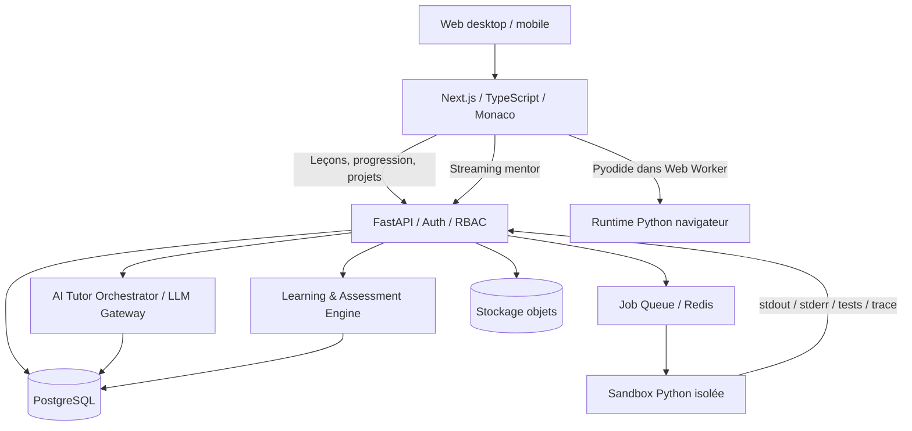

# Architecture cible — Python Nova

Statut : design proposé, à faire évoluer via ADR (Architecture Decision Records). Aucune composante ci-dessous n'est déclarée implémentée.

## Vue générale


## Choix proposés
- Frontend : Next.js + React + TypeScript ; Tailwind CSS ; composants accessibles ; Monaco Editor.
- Python débutant : Pyodide dans Web Worker, avec limites de durée et redémarrage du worker.
- Python avancé : exécution distante isolée (sandbox éphémère ; limites temps, CPU, mémoire, disque ; restrictions réseau et syscalls).
- Backend : FastAPI ; API REST versionnée ; SSE pour streaming texte ; WebSocket uniquement pour les cas bidirectionnels utiles.
- Persistance : PostgreSQL ; stockage objet pour projets/artefacts ; Redis pour queues et cache.
- Identity : OIDC / sessions sécurisées ; RBAC (learner, educator, admin) ; supervision spécifique mineurs.
- Observabilité : OpenTelemetry, métriques Prometheus/Grafana, erreurs et coûts agrégés.
- Déploiement : frontend Vercel possible, backend et workers sur infrastructure distincte ; CI GitHub Actions ; environnement dev/staging/prod séparé.

## Interfaces et contrats MVP
- `GET /api/v1/lessons/:id` : contenus versionnés et exercices.
- `POST /api/v1/submissions` : solution, tests, verdict objectif, niveau d'aide déclaré.
- `GET /api/v1/progress` : progrès et compétences acquises.
- `POST /api/v1/tutor/sessions` : session pédagogique contextualisée.
- `POST /api/v1/tutor/sessions/:id/messages` : streaming d'indices et explications.
- Exécution Pyodide directement dans le navigateur ; soumission serveur pour validation et anti-triche raisonnable.
- Phase avancée : `POST /api/v1/runs` (job sandbox) et `GET /api/v1/runs/:id`.

### Entités de données (proposition)
`User`, `LearnerProfile`, `Lesson`, `Concept`, `ConceptPrerequisite`, `Exercise`, `ExerciseTest`, `Attempt`, `HintEvent`, `MasteryEvidence`, `Progress`, `Project`, `ProjectVersion`, `TutorSession`, `TutorMessage`, `Assessment`, `AuditEvent`.

Chaque exercice doit inclure : objectif pédagogique, prérequis, consigne accessible, starter code, tests publics, tests cachés côté serveur, solution de référence interne, messages d'erreur et version de contenu.

## IA : chaîne de décision
1. Récupérer code, leçon, objectif, historique pertinent et préférences pédagogiques (minimisation).
2. Exécuter tests / analyser erreurs avant la génération si nécessaire.
3. Déterminer le mode : apprendre / explorer / évaluation.
4. Appliquer la politique d'indices gradués et construire un contexte borné.
5. Appeler le modèle via passerelle (timeouts, budgets, provider fallback).
6. Filtrer les sorties, gérer prompt injection, journaliser métadonnées sans secrets.
7. Streaming de la réponse, puis feedback utilisateur facultatif.
8. Mise à jour de maîtrise basée sur preuves, pas sur impression du LLM.

**Le LLM ne doit jamais inventer un résultat de test.** Les résultats proviennent d'un runtime vérifié.

## Risques de sécurité
- Tout code soumis est hostile par défaut. Ne jamais utiliser `exec` dans le processus API.
- Docker seul n'est pas une frontière de sécurité suffisante. Définir l'isolation de production (microVM/gVisor/équivalent) après évaluation.
- Réseau désactivé pour les sandboxes par défaut ; FS temporaire ; aucun secret accessible.
- Limites par session/compte/IP ; anti-abus, budget IA et quotas de calcul.
- Protection XSS, CSRF, injection SQL, protections de dépendances et scan de secrets.
- Aucun token API de LLM dans le frontend.
- Journalisation minimisée, rétention définie, effacement/export, localisation des données à arbitrer.
- Consentement, sécurité renforcée et fonctions sociales désactivées par défaut pour mineurs.
- Étude RGPD et AI Act avant usages de notation/placement institutionnels ; effectuer une analyse juridique par contexte.

## Non-fonctionnel et qualité
- Accessibilité WCAG 2.2 AA cible.
- Autosave et reprise après déconnexion.
- Latence d'exécution navigateur interactive ; streaming d'IA avec premier feedback visé ≤3 s en conditions définies.
- Fiabilité : tests unitaires, intégration, E2E, sécurité, performance et pédagogie.
- Golden dataset de questions Python + évaluations humaines et régressions IA.
- Features flags pour modules expérimentaux.
- Éviter de stocker des données sensibles dans les prompts.

## Monorepo proposé
```text
apps/
  web/                 # Next.js
  api/                 # FastAPI
packages/
  ui/                  # Design system
  curriculum/          # Contenus, versions et schémas
  shared-types/        # Contrats API
services/
  sandbox-worker/      # Exécution serveur isolée, future
  learning-engine/     # Compétences, diagnostic
docs/
  ...
```
Lancer d'abord le minimum fonctionnel ; ne pas provisionner tous les services avant nécessité.
